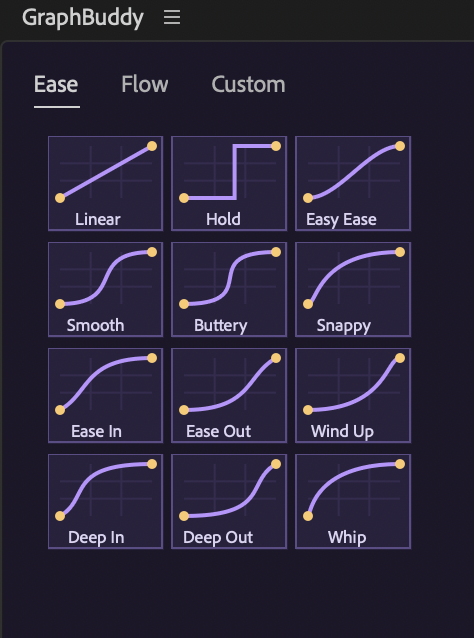
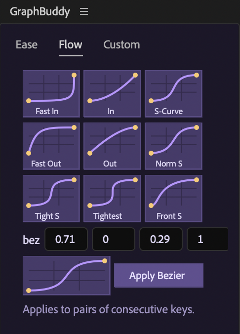
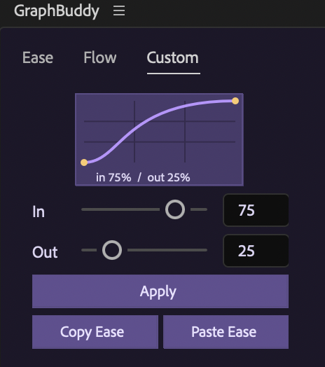
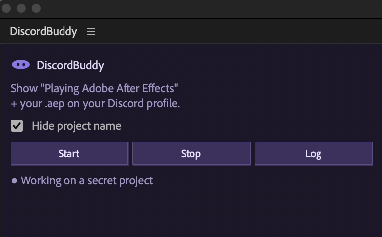
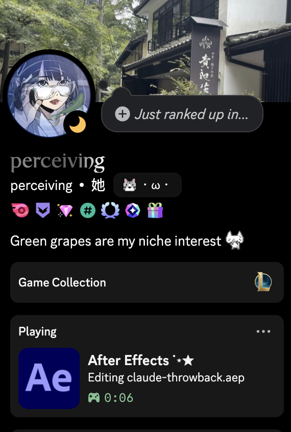

# softplugins

my own ae plugins for free

## install

On macOS, install every buddy at once from the repo folder:

```bash
./install.sh
```

It copies each `<Name>.jsx` and its `<Name>_lib` folder into every After Effects in `/Applications`. That folder belongs to the system, so it asks for your Mac password once. Restart After Effects, then open **Window → BuddyHub.jsx**.

- Re-run it after pulling updates. It replaces the old copies, including the lib folders, so no stale modules are left behind.
- `./install.sh TextBuddy GraphBuddy` installs just the ones you name.
- `./install.sh --uninstall` removes them again.
- `./install.sh --dest <folder>` uses another ScriptUI Panels folder.

On Windows, or to install by hand, follow the Install steps in each buddy's README.

## plugins

- **[BuddyHub](BuddyHub/)** — the home page: a dockable launcher listing every installed Buddy with its icon; click to open or close its panel. New buddies appear automatically. See [BuddyHub/README.md](BuddyHub/README.md).
- **[GraphBuddy](GraphBuddy/)** — one-click graph editor eases for After Effects: graph-tile ease presets, Flow-style cubic-bezier pack, object morphing, loops, and motion FX. See [GraphBuddy/README.md](GraphBuddy/README.md) for install + docs.
- **[TextBuddy](TextBuddy/)** — one-click text animation: word-by-word reveals with Offset keys, plus the "animate text like Apple" looks (Drop, Rise, Lift, Slide, slide/scale match cuts with drift, hand-drawn underline). See [TextBuddy/README.md](TextBuddy/README.md).
- **[DiscordBuddy](DiscordBuddy/)** — Discord Rich Presence for After Effects: shows *"Playing Adobe After Effects"* with your current `.aep` on your Discord profile. No account setup — the Discord app connection is built in, just press Start. See [DiscordBuddy/README.md](DiscordBuddy/README.md) for install + docs.

## examples

### GraphBuddy

<p>
  
  
  
</p>

### DiscordBuddy

<p>
  
  
</p>
